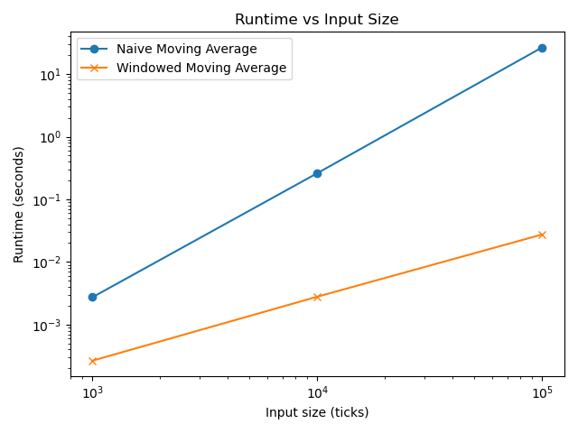
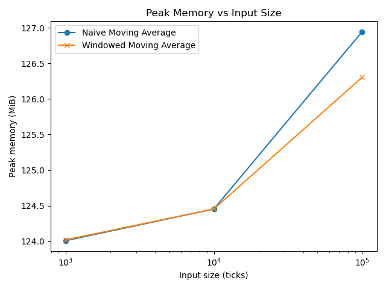

# Runtime & Space Complexity in Financial Signal Processing

A small Python module that ingests 100,000 ticks of market data and runs three moving-average trading strategies with different time and space complexity. Each strategy is profiled with **timeit**, **cProfile**, **line_profiler** and **memory_profiler**, and the measurements are compared with the Big-O analysis.



---

## Strategies

Each strategy reads one price per tick and emits a `BUY`, `SELL` or `HOLD` signal by comparing the price with a moving average.

| Strategy | How it computes the average | Time per tick | Total time (n ticks) | Space |
|---|---|:-:|:-:|:-:|
| `NaiveMovingAverageStrategy` | Re-sums every price seen so far | O(n) | **O(n²)** | O(n) prices + O(n) signals |
| `WindowedMovingAverageStrategy` | Running sum over a deque of the last k = 10 prices | O(1) | **O(n)** | O(k) prices + O(n) signals |
| `BetterMovingAverageStrategy` | Running sum and count (same average as the naive one) | O(1) | **O(n)** | O(1) state + O(n) signals |

## Results

Best of 3 `timeit` runs and peak process memory (`memory_profiler`) on the first n ticks:

| Ticks | Naive | Windowed | Naive peak memory | Windowed peak memory |
|---:|---:|---:|---:|---:|
| 1,000 | 0.0027 s | 0.0003 s | 124.01 MiB | 124.02 MiB |
| 10,000 | 0.2613 s | 0.0028 s | 124.45 MiB | 124.45 MiB |
| 100,000 | **26.54 s** | **0.027 s** | 126.95 MiB | 126.30 MiB |

The running-mean `BetterMovingAverageStrategy` processes 100,000 ticks in **0.019 s** and produces exactly the same signals as the naive strategy (checked in the tests).

**Key findings**
- **The measurements match the Big-O analysis.** Each 10× increase in input multiplies the naive runtime by about 100× (quadratic) and the windowed runtime by about 10× (linear). At 100K ticks, the incremental update is about **1,000× faster**.
- **line_profiler finds the bottleneck.** In the naive strategy, `sum(self.prices) / len(self.prices)` takes 99.4% of the time at 100K ticks. In the windowed strategy, the time is spread evenly across constant-time lines. The full line profiles are in [`complexity_report.md`](complexity_report.md).
- **Memory differences are small at this scale.** Peak memory is dominated by the ~124 MiB Python process and the 100K loaded `MarketDataPoint` objects. The strategies themselves only add lists of at most 100K references.



## Project structure

| File | Purpose |
|---|---|
| [`models.py`](models.py) | `MarketDataPoint` (frozen dataclass) and the `Strategy` abstract base class |
| [`data_loader.py`](data_loader.py) | Reads the CSV into a list of `MarketDataPoint`, validating columns and rows |
| [`strategies.py`](strategies.py) | The three strategies, with complexity annotations on each line |
| [`profiler.py`](profiler.py) | `timeit`, `memory_profiler`, `cProfile` and `line_profiler` helpers |
| [`reporting.py`](reporting.py) | Runtime and memory plots |
| [`main.py`](main.py) | Runs the benchmark for 1K, 10K and 100K ticks |
| [`complexity_report.md`](complexity_report.md) | Complexity analysis and line-by-line profiles |
| [`tests/`](tests/) | Unit tests for the loader and strategies |

## Getting started

```bash
pip install -r requirements.txt
python main.py                               # ~3 min: prints the table, saves assets/*.png and results/lineprofile_*.txt
python -m unittest discover -s tests -v
```

## Data

`data/market_data.csv` has 100,000 rows of `timestamp, price, symbol`. The first 250 rows are NVIDIA (NVDA) daily prices for 2025, newest first. The rest pad the file to 100,000 ticks with a constant price. The values don't affect the complexity measurements; they only set the input size.

## Limitations

- **Peak memory is process-wide.** `memory_profiler` samples the whole process every 0.1 s, so differences of about 1 MiB are within noise. The order of the naive and windowed lines even flipped between runs at 100K ticks. `tracemalloc` would measure each strategy's own allocations more precisely.
- **Padded data.** Because most of the file is a constant price, the signals after the first 250 ticks are not meaningful as trading signals. The project measures computational cost, not strategy returns.

## Tech stack

Python · timeit · cProfile · line_profiler · memory_profiler · Matplotlib · unittest

---

*Built as part of my master's program at the University of Chicago.*
